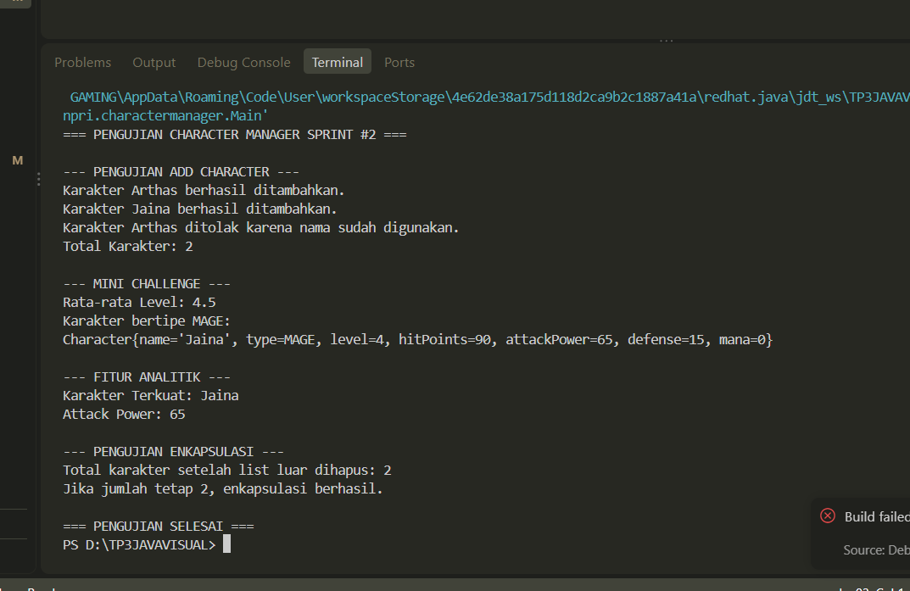

# TP5 — Character Manager: Implementasi dan Analisis

## A. Implementasi Core

Pada tugas TP5, project CharacterManager dikembangkan dengan beberapa fitur utama:

1. `addCharacter()` digunakan untuk menambahkan karakter baru ke dalam daftar.
2. `findByName()` digunakan untuk mencari karakter berdasarkan nama.
3. `removeCharacter()` digunakan untuk menghapus karakter.
4. `getTotalCharacters()` digunakan untuk menghitung jumlah karakter.
5. `getAllCharacters()` digunakan untuk mendapatkan salinan daftar karakter.

Penambahan karakter dengan nama duplikat ditolak agar setiap karakter memiliki nama yang unik.

## B. Mini-Challenge

Dua fitur tambahan yang berhasil diimplementasikan:

**1. getAverageLevel()**

Method ini menghitung rata-rata level seluruh karakter. Jika daftar karakter kosong, method mengembalikan nilai 0 agar tidak terjadi pembagian dengan nol.

**2. findByType(CharacterType type)**

Method ini mencari karakter berdasarkan tipe, seperti WARRIOR, MAGE, ARCHER, dan HEALER. Hasil pencarian dikembalikan dalam ArrayList baru.

## C. Fitur Analitik Rancangan Sendiri

**Nama fitur: findStrongest()**

Fitur ini digunakan untuk mencari karakter dengan nilai attack power tertinggi.

Cara kerjanya adalah membandingkan attack power setiap karakter di dalam daftar. Karakter dengan nilai tertinggi akan dikembalikan sebagai hasil.

Fitur ini menjaga encapsulation karena tidak memberikan akses langsung ke ArrayList internal. Jika daftar karakter kosong, method mengembalikan null.

## D. Analisis Reference dan Rancangan
Dokumen analisis Google Docs:
[https://docs.google.com/document/d/1YrTA3958sfEFp4XMNh6fify3srqYMuRkAfbKGOF1kN8/edit?usp=sharing]

## E. Screenshot Hasil Pengujian
### 1. Output Program TP5

