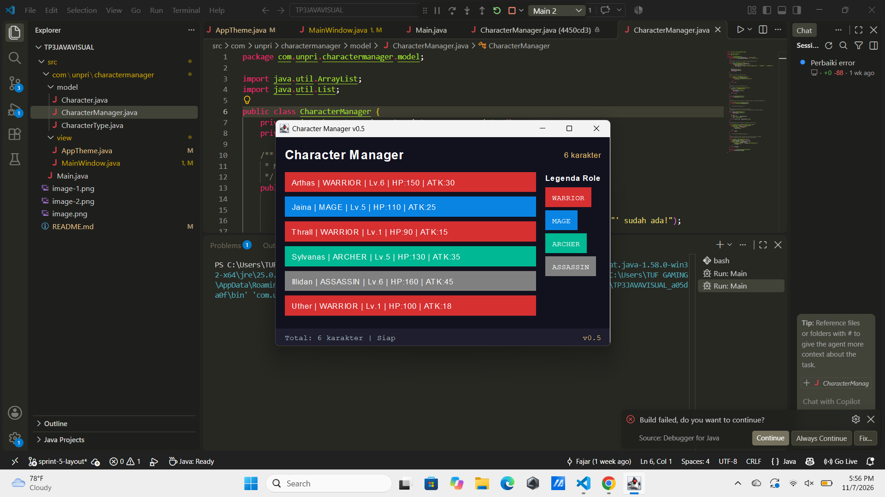
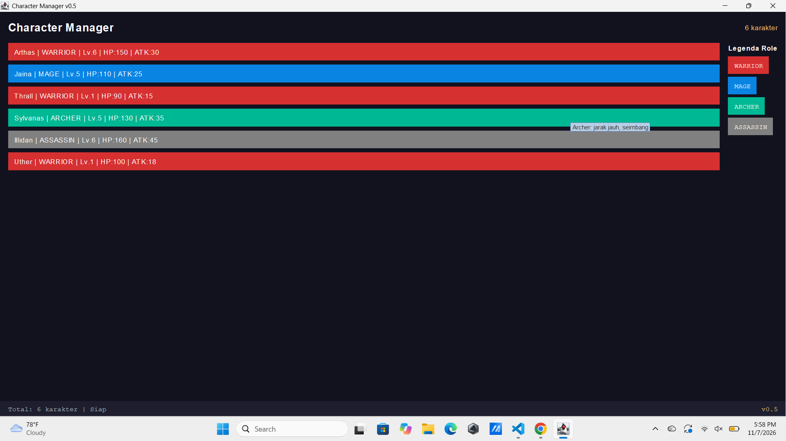
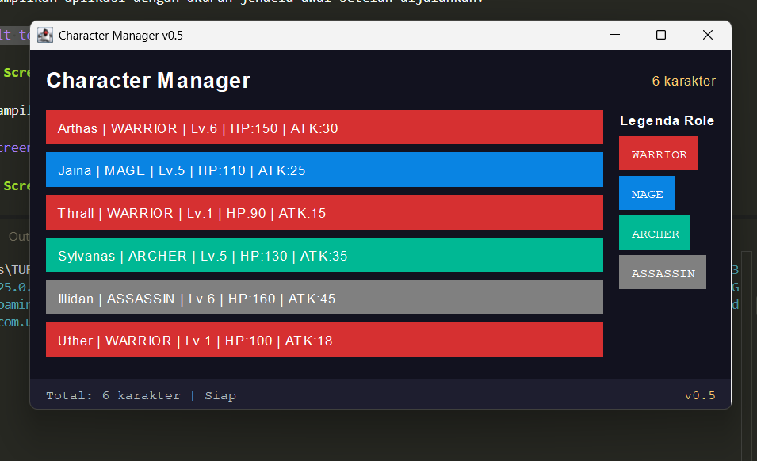

# Character Manager — Sprint #5
## Layout, UI Responsif & Analisis MVC

**Mata Kuliah:** AP16 Belajar Praktik  
**Tugas:** TP12  
**Nama:** [Nama Lengkap]  
**NIM:** [NIM]  
**Kelas:** [Kelas]  
**Program Studi:** Sistem Informasi  
**Universitas:** Universitas Prima Indonesia (UNPRI)

---

# 1. Deskripsi Aplikasi

Character Manager merupakan aplikasi berbasis Java Swing yang digunakan untuk mengelola dan menampilkan data karakter. Setiap karakter memiliki informasi berupa nama, role, level, Hit Points (HP), dan Attack Power (ATK).

Pada Sprint #5, aplikasi dikembangkan dengan memperbaiki tata letak antarmuka agar lebih rapi, responsif, dan mudah digunakan ketika ukuran jendela diperbesar maupun diperkecil.

Pengembangan ini menggunakan beberapa Layout Manager, yaitu BorderLayout, GridLayout, BoxLayout, dan FlowLayout.

# 2. Struktur Layout Aplikasi

Aplikasi menggunakan BorderLayout sebagai layout utama dengan empat wilayah:

| Wilayah | Komponen | Fungsi |
|---|---|---|
| NORTH | Header | Menampilkan judul aplikasi dan jumlah karakter |
| CENTER | JScrollPane | Menampilkan daftar kartu karakter |
| EAST | Legenda Role | Menampilkan warna berdasarkan jenis karakter |
| SOUTH | Status Bar | Menampilkan jumlah karakter dan versi aplikasi |

## Wireframe Aplikasi

Berikut rancangan struktur tampilan Character Manager:

```text
+------------------------------------------------------+
|                    NORTH (HEADER)                    |
|  Character Manager                 8 Karakter        |
+------------------------------------------------------+
|                              |                       |
|          CENTER              |        EAST           |
|                              |                       |
|   +----------------------+   |   LEGENDA ROLE        |
|   | Karakter 1           |   |                       |
|   +----------------------+   |   [WARRIOR]            |
|   | Karakter 2           |   |   [MAGE]               |
|   +----------------------+   |   [ARCHER]             |
|   | Karakter 3           |   |                       |
|   +----------------------+   |                       |
|                              |                       |
+------------------------------------------------------+
|                    SOUTH (STATUS)                    |
|  Total: 8 karakter | Siap                    v0.5    |
+------------------------------------------------------+
```

## Panel Bersarang (Nested Panel)

Aplikasi menggunakan konsep panel bersarang atau Nested Panel, yaitu panel yang ditempatkan di dalam panel lainnya. BorderLayout digunakan sebagai kerangka utama aplikasi, sedangkan setiap bagian memiliki panel dengan layout masing-masing. Daftar karakter menggunakan GridLayout agar kartu tersusun secara vertikal dengan jarak yang konsisten. Legenda menggunakan BoxLayout Y_AXIS agar setiap role tersusun dari atas ke bawah. Penggunaan panel bersarang membuat tampilan lebih terorganisasi dan mudah dikembangkan.

# 3. Layout Tambahan

Pada pengembangan Sprint #5, direncanakan penambahan panel statistik menggunakan GridLayout 2×2.

Panel statistik menampilkan empat informasi:
1. Total karakter.
2. Rata-rata level karakter.
3. Jumlah role.
4. Karakter dengan Attack Power tertinggi.

### Alasan Memilih GridLayout

GridLayout dipilih karena dapat membagi panel menjadi empat bagian dengan ukuran yang sama. Dengan susunan 2 baris dan 2 kolom, informasi statistik dapat ditampilkan secara teratur dan mudah dibaca.

### Layout yang Tidak Dipilih

FlowLayout tidak dipilih untuk panel statistik karena susunan komponennya mengikuti aliran horizontal dan dapat berpindah baris ketika ruang tidak mencukupi. Sementara itu, GridLayout memberikan susunan yang lebih konsisten untuk empat informasi statistik.

# 4. Pengamatan Responsive Layout

Pengujian dilakukan dengan mengubah ukuran jendela aplikasi untuk melihat bagaimana komponen menyesuaikan ruang yang tersedia.

| No. | Kondisi Jendela | Prediksi | Hasil Pengamatan |
|---|---|---|---|
| 1 | Ukuran awal | Semua komponen terlihat rapi | [Isi setelah pengujian] |
| 2 | Jendela diperbesar | Area daftar karakter melebar dan ruang menyesuaikan | [Isi setelah pengujian] |
| 3 | Jendela diperkecil | Daftar karakter menggunakan scrollbar ketika diperlukan | [Isi setelah pengujian] |

## Screenshot Pengujian

### Screenshot 1 — Ukuran Awal

Menampilkan aplikasi dengan ukuran jendela awal setelah dijalankan.



### Screenshot 2 — Jendela Diperbesar

Menampilkan perubahan tata letak ketika ukuran jendela diperbesar.



### Screenshot 3 — Jendela Diperkecil

Menampilkan tampilan aplikasi ketika ukuran jendela diperkecil hingga scrollbar daftar karakter terlihat.



# 5. Penggunaan Layout Manager

### BorderLayout

Digunakan sebagai layout utama JFrame untuk membagi aplikasi menjadi wilayah NORTH, SOUTH, EAST, WEST, dan CENTER.

### GridLayout

Digunakan untuk menyusun kartu karakter dalam satu kolom. GridLayout juga digunakan pada panel statistik dengan susunan 2×2.

### BoxLayout

Digunakan pada panel legenda role dengan arah vertikal menggunakan BoxLayout.Y_AXIS.

### FlowLayout

FlowLayout merupakan layout sederhana yang menyusun komponen secara berurutan. Layout ini dipertimbangkan untuk komponen yang tidak membutuhkan susunan kisi tetap.

# 6. Konsep MVC

Aplikasi Character Manager menerapkan konsep Model-View-Controller (MVC) untuk memisahkan tanggung jawab program.

- **Model:** Mengelola data karakter, seperti Character, CharacterType, dan CharacterManager.
- **View:** Mengatur tampilan aplikasi, seperti MainWindow dan AppTheme.
- **Controller:** Menghubungkan tindakan pengguna dengan proses pengelolaan data dan pembaruan tampilan.

Pemisahan ini membuat program lebih terstruktur, mudah diperbaiki, dan dikembangkan tanpa harus mengubah seluruh bagian aplikasi.

# 7. Kesimpulan

Pada Sprint #5, aplikasi Character Manager dikembangkan dengan menerapkan berbagai Layout Manager pada Java Swing. Penggunaan BorderLayout, GridLayout, dan BoxLayout membantu menghasilkan tampilan yang lebih terstruktur. JScrollPane memungkinkan daftar karakter tetap dapat diakses ketika jumlah karakter bertambah. Selain itu, konsep MVC membantu memisahkan pengelolaan data dengan tampilan aplikasi sehingga program lebih mudah dipelihara dan dikembangkan.

---

**Character Manager v0.5**  
Universitas Prima Indonesia (UNPRI)  
Program Studi Sistem Informasi