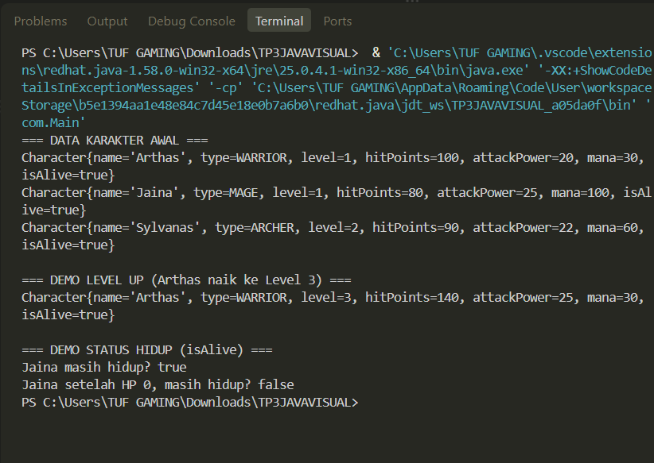

# Character Manager — TP3 (Java Visual SIH-6406)

## Deskripsi Singkat
Aplikasi berbasis Java konsol ini dirancang sebagai fondasi model class untuk manajemen karakter game (Character Manager). Proyek ini menerapkan konsep Object-Oriented Programming (OOP) seperti enkapsulasi, penggunaan constructor overloading, enum, serta validasi atribut secara ketat.

## Screenshot Output Terminal
*(Masukkan screenshot hasil run terminal Anda di sini, pastikan menampilkan output `isAlive()`)*
```bash
[Contoh Tampilan Output Terminal]
=== DATA KARAKTER AWAL ===
Character{name='Arthas', type=WARRIOR, level=1, hitPoints=100, attackPower=20, mana=30, isAlive=true}
...
https://docs.google.com/document/d/15tznjK5KhScaTC756uG_VeQPY745pMouZWlfko9QqXY/edit?usp=sharing
