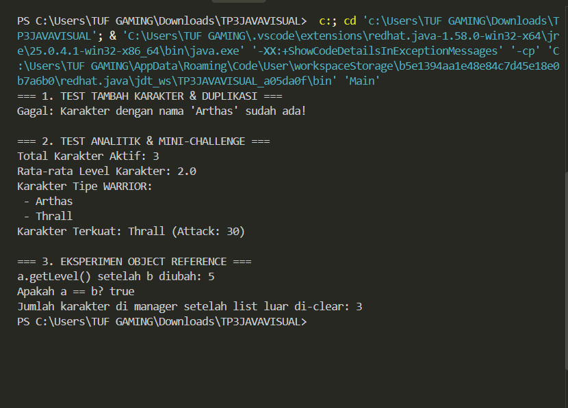
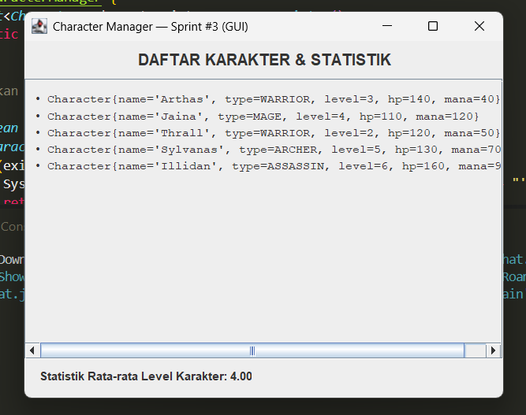

# Character Manager — TP3 (Java Visual SIH-6406)

## Deskripsi Singkat
Aplikasi berbasis Java konsol ini dirancang sebagai fondasi model class untuk manajemen karakter game (Character Manager). Proyek ini menerapkan konsep Object-Oriented Programming (OOP) seperti enkapsulasi, penggunaan constructor overloading, enum, serta validasi atribut secara ketat.

## Screenshot Output Terminal
[alt text](image.png)
```bash
[Contoh Tampilan Output Terminal]
=== DATA KARAKTER AWAL ===
Character{name='Arthas', type=WARRIOR, level=1, hitPoints=100, attackPower=20, mana=30, isAlive=true}
...
https://docs.google.com/document/d/15tznjK5KhScaTC756uG_VeQPY745pMouZWlfko9QqXY/edit?usp=sharing


# Character Manager — TP5 (Java Visual SIH-6406)

## Deskripsi Singkat
Aplikasi berbasis Java ini merupakan pengembangan Sprint #2 (TP5) untuk **Character Manager**. Pada versi ini, aplikasi dilengkapi dengan manajemen koleksi `List<Character>`, penanganan duplikasi nama karakter, pengecekan objek referensi, pemenuhan prinsip enkapsulasi (*Defensive Copy*), fitur analitik rata-rata level, filter tipe karakter, serta pencarian karakter terkuat.

---

## Fitur & Analitik Mandiri (Bagian C)
* **Fitur Mandiri:** `findStrongestCharacter()`
* **Deskripsi:** Method ini memindai seluruh karakter di dalam daftar dan mengembalikan objek `Character` yang memiliki nilai `attackPower` tertinggi.
* **Rasional Desain & Enkapsulasi:** Method ini mengembalikan objek karakter terkuat secara opsional tanpa mengekspos list internal `characterList`, sehingga enkapsulasi tetap terjaga dengan aman.

---

## Screenshot Output Terminal
*()

---

## Struktur Folder Project
```text
javavisual-tp5-[253303621268]/
└── CharacterManager/
    └── src/
        └── com/
            └── unpri/
                └── charactermanager/
                    ├── model/
                    │   ├── Character.java
                    │   ├── CharacterManager.java
                    │   └── CharacterType.java
                    └── Main.java
                    
****************https://docs.google.com/document/d/1EIJS8eMNeiLUt4lro79V67FLvGUWUX4Ye0rOyS_x-Xg/edit?usp=sharing

## TP8 — Character Manager Sprint #3 (GUI & MVC)

### 1. Screenshot MainWindow
*()

### 2. Alur Data (Main → CharacterManager → MainWindow) dalam Konsep MVC
* **Model (`Character` & `CharacterManager`):** Menyimpan data mentah, daftar karakter, serta logika bisnis seperti perhitungan rata-rata level.
* **Controller (`Main`):** Menginisialisasi data objek, menyusun manager, serta memicu pembuatan tampilan GUI secara aman menggunakan `SwingUtilities.invokeLater`.
* **View (`MainWindow`):** Mengambil data secara dinamis dari Model (melalui perantara manager) menggunakan perulangan *loop*, lalu merender komponen visual ke layar pengguna tanpa mengubah data aslinya.

### 3. Daftar Karakter Baru & Alasan Pemilihan Tipe/Level
* **Arthas (WARRIOR - Level 3):** Dipilih sebagai petarung garis depan dengan HP tinggi.
* **Jaina (MAGE - Level 4):** Penyihir dengan kapasitas Mana besar dan serangan sihir tinggi.
* **Thrall (WARRIOR - Level 2):** Karakter pejuang pendukung dengan statistik seimbang.
* **Sylvanas (ARCHER - Level 5):** Pemanah tingkat lanjut dengan ketangkasan dan attack power tinggi.
* **Illidan (ASSASSIN - Level 6):** Karakter level tertinggi dengan attack power paling mematikan.

### 4. Link Google Docs Analisis GUI & MVC (Bagian D)
* [Link Google Docs TP8 Analisis GUI & MVC](https://docs.google.com/document/d/1pAwStmnKpCy0FHq3qnMg_73EXeotQkbfwwg4EJBbzys/edit?usp=sharing)

## TP10 — Character Manager Sprint #4 (Theming & Properti Komponen)

### 1. Screenshot Tampilan Aplikasi
*(Tambahkan dua screenshot di bawah ini untuk membuktikan perubahan tampilan)*

* **Sebelum (v0.3 - TP8):**  
  

* **Sesudah (v0.4 - TP10):**  
  

---

### 2. Mengapa Warna Disimpan di `AppTheme` dan Bukan di Class `Character`?
Pengaturan warna dan aspek visual disimpan di dalam class `AppTheme` (layer View) untuk menerapkan prinsip **Separation of Concerns** dan menjaga arsitektur **MVC**:
1. **Model Terisolasi:** Class `Character` (Model) bertugas murni mengelola data bisnis (seperti nama, role, level, HP, dan Mana) tanpa perlu tahu bagaimana data tersebut akan digambar di layar.
2. **Fleksibilitas & Reuse:** Jika aplikasi kelak ingin diubah ke tema lain (misalnya Light Mode / Dark Mode) atau di-porting ke platform lain (seperti Web atau Android), kode di Model tidak perlu diubah sama sekali.
3. **Mencegah High Coupling:** Menyimpan objek `Color` milik Java Swing di dalam `Character` akan membuat Model terikat erat dengan library GUI Swing.

---

### 3. Daftar Properti Tambahan yang Dipilih & Alasannya
1. **Tooltip (`card.setToolTipText(...)`):**
   * **Fungsi:** Menampilkan informasi detail berupa statistik *Hit Points* (HP) dan *Attack Power* (ATK) saat kursor mouse diarahkan ke kartu karakter.
   * **Alasan:** Memberikan informasi tambahan secara interaktif kepada pengguna tanpa memenuhi ruang antarmuka utama.
2. **Status Non-Aktif (`card.setEnabled(false)`):**
   * **Fungsi:** Mengunci dan menonaktifkan tampilan kartu karakter yang masih berada di **Level 1** (misalnya karakter baru / pemula).
   * **Alasan:** Memberikan umpan balik visual bahwa karakter level 1 masih terikons/belum siap digunakan dalam pertarungan.

---

### 4. Link Google Docs Analisis Properti & MVC (Bagian D)
* [Link Google Docs TP10 Analisis Properti & MVC](https://docs.google.com/document/d/1jwWFHzncyJW6FZEWK7SYih6M9EN95PCkry7SBxZ7ZcI/edit?usp=sharing)