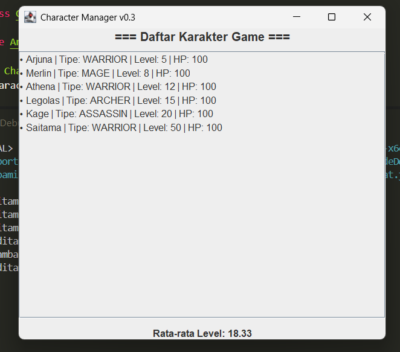

## TP8

### 1. Screenshot MainWindow
  

### 2. Aliran Data Aplikasi (MVC)
Aliran data diawali dari `Main.java` yang menginstansiasi `CharacterManager` untuk mengelola objek `Character` sebagai representasi layer Model. Selanjutnya, `Main.java` mengambil seluruh daftar karakter melalui metode `manager.getAllCharacters()` dan meneruskannya ke dalam *constructor* `MainWindow`. Komponen `MainWindow` yang bertindak sebagai layer View menerima koleksi data tersebut lalu melakukan iterasi secara dinamis untuk merender daftar karakter serta menghitung statistik rata-rata level pada antarmuka GUI.

### 3. Daftar Karakter Baru
* **Legolas** (Tipe: `ARCHER`, Level: 15): Dipilih dengan tipe `ARCHER` untuk menambahkan variasi kelas *ranged/physical damage* dengan level menengah tinggi.
* **Kage** (Tipe: `ASSASSIN`, Level: 20): Dipilih dengan tipe `ASSASSIN` untuk menguji kelas *stealth/high-burst* serta memberikan nilai level paling tinggi agar korelasi angka rata-rata level terlihat dinamis.

### 4. Tautan Analisis GUI & MVC (Bagian D)
Link Document: (https://docs.google.com/document/d/1ZasFK_en9XI1oH-yYi7bS6AHBCSMHjqVgkVWFfIk8uo/edit?usp=sharing)